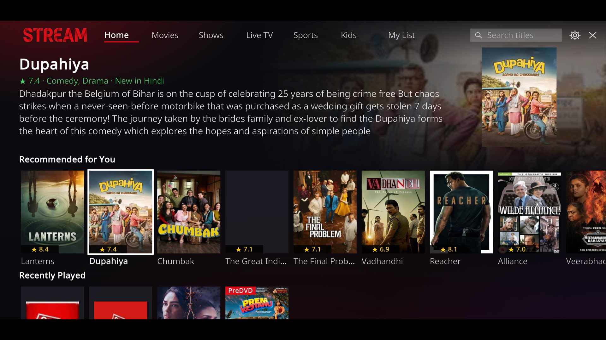

# Stream for Kodi



A poster-row home screen for Kodi that sits on top of the Sasta TV addon: tabs for Movies, Shows, Live TV, Kids and YouTube,
Continue Watching, My List, ranked search, and a "Recommended for You" row.

Stream does not provide any content or accounts. It only re-presents what the Sasta TV addon already lists, and hands
playback to that addon, so Sasta TV must be installed and signed in on the same Kodi.

## Install

1. In Kodi, open **Settings → System → Add-ons** and turn on **Unknown sources**.
2. Open **Settings → File manager → Add source**, choose **<None>**, and enter
   `https://raw.githack.com/yeshvantbhavnasi/kodi-stream/main/` (keep the final slash). Name it `stream`.
3. Open **Add-ons → Install from zip file → stream** and choose `repository.stream-1.0.1.zip`.
4. Open **Add-ons → Install from repository → Stream Repository → Video add-ons → Stream** and install it.

Updates then arrive through the repository.

## Setting up another TV

The same steps on every box, for a Fire TV Stick, Google TV or any Android TV running Kodi:

1. Optional, for the Tailscale address: install **Tailscale** (Amazon Appstore on Fire TV, Play Store on Google TV),
   sign in with the login link or QR code it shows, and accept the VPN prompt. In the Tailscale admin console,
   open the new device and choose **Disable key expiry** so it never silently signs out.
2. Install Kodi, then Stream as described under *Install* above.
3. Open Stream and go through the first-run setup (languages and profiles). The service address and key are built
   in (`https://recs.senapati.si`, which works from any network), so nothing is typed; a box on the tailnet can use
   `http://yeshvants-mac-mini.tail1fe071.ts.net:8770` under **Settings → AI** instead.
4. Within a minute the Recommended for You row shows "· AI", and the Mac's `~/Library/Logs/stream-recs.log` lists
   the new box by name.

Without Tailscale the box can still browse and play; only recommendations and smart search need the service.

## Opening Stream

Once installed, Stream opens by itself whenever Kodi starts. Closing Stream returns to Kodi's own home screen, and it can be
reopened from **Add-ons → Video add-ons → Stream**. To stop it opening at start-up, switch off
**Settings → Options and keys → General → Open Stream when Kodi starts**.

## Using it

Everything works with the remote's direction pad, OK and Back; no mouse or pointer is needed.

| Action | How |
|---|---|
| Move around | Direction pad. Up and Down move between rows, Left and Right along a row. Lists stop at their edges instead of wrapping |
| Switch section | Move along the top bar: Home, Movies, Shows, Live TV, Sports, Kids, YouTube, My List, History. The section appears as soon as it is highlighted; Down moves into it |
| Search | The search bar at the top right. OK opens the keyboard |
| Settings | The gear icon at the top right |
| Close Stream | The ✕ icon at the top right, or Back from the Home section (it asks first) |
| Go back one level | Back: rows → top bar → Home section → exit |
| Jump to Home from any inner screen | The **⌂ Home** tile at the start of the list, or hold OK and pick **Go to Home** |
| Cancel a stream that is starting | Back while the "Starting…" message is showing |
| Stop a stream and keep browsing | Back while the video is playing. The stream stops and you return to where you were |
| Add or remove a title from My List | Hold OK (or press the menu key) on the title |
| Like or dislike a title | Hold OK on the title and pick **Like** or **Dislike** |
| Open a title | OK on a movie or show opens its page: Play (or Resume), Trailer, My List, Like and Dislike, then a show's seasons and episodes or a movie's **More like this** row. OK on an episode plays it |
| Hide a suggestion | Hold OK on it in "Top Picks for You" and pick **Not interested** |
| Resume a title | Play it again; it carries on from where it stopped. A red bar under the poster shows how far in it is. Hold OK and pick **Play from the beginning** to start over |
| Tidy Continue Watching or History | On a part-watched tile press the remote's Delete (Clear) key, or hold OK and pick **Remove from Continue Watching**; the title stays in History and plays from the start next time. **Remove from History** is in the same menu |
| Search YouTube | On the YouTube section the search bar searches YouTube. Elsewhere a **Search YouTube for …** tile sits at the end of the results, first when nothing in the catalogue matched |
| Browse by genre | The genre strip under the description panel on Movies and Shows (Down from the top bar): OK on Action, Comedy, Thriller & Crime, Romance and so on filters the rows to that genre, one row per language, your first language first. **All** clears it |
| See everything watched | The **History** section: unfinished titles, then everything played, newest first |

### What the home screen shows

Rows are built by the recommendation engine (see *How recommendations work*) from everything the catalogue holds, up
to forty titles each with **See all** at the end. They appear only when there is something to put in them, and your
first language leads every list:

- **Continue Watching** and **Top Picks for You**: the best of the whole catalogue for this household. A list posted
  to the recommendation service by another bot leads the row (see *How recommendations work*), then a model's own
  picks with their reasons when one is set up, then the local ranking, mostly movies.
- **Tonight: Movies, Shows and Videos**: the top picks with the best YouTube videos for you mixed in.
- **Because you watched …**: two rows of titles like the ones watched last, from TMDb's picks that exist in the
  catalogue, filled out with titles of the same genres in the same language.
- **New Releases**: titles that appeared in the catalogue in the last seven days (after Stream has been installed for a couple of days).
- **Top 10 Telugu Movies**, **Top 10 Telugu Shows** and the next language's movies: India's streaming charts (Netflix,
  Aha and TMDb's buzz), one row per language and kind, keeping only titles the catalogue can play. A row needs at
  least three playable titles to appear.
- **Top 10 in Your Home**: what every profile on this device played most in the last month.
- Genre rows in your first two languages, named after what you watch most: **Telugu Thrillers**, **Hindi Comedies** and so on.
- **Cricket: Live and Upcoming** when the household follows cricket: matches on now or starting within a day and a
  half (internationals and the big leagues, India first), from the recommendation service's fixtures (ESPN's public
  feed, refreshed every half hour), each on the catalogue's live event for it or on the cricket channels. The row
  sits near the top while a match is on or starts today.
- **Highly Rated in …**, **Shows to Binge**, **YouTube for You**, **More videos like …**, **On Netflix** / **On Aha** /
  **On Prime Video** (where the titles originally stream, from TMDb), **Hidden Gems**, **My List**, live events and YouTube.

The billboard shows the highlighted title's rating, length (or number of seasons), genres and a short synopsis; its own
page (OK) has the cast, where it streams, the trailer, and a show's episodes. After a minute without a key press the
home screen walks the highlight along the top picks so the billboard shows them off; any key stops it.

### First-run setup

The first time Stream opens it asks five questions: which languages you watch, what you like to watch, which sports
you follow, your favourite actors or directors (optional; a list of the names seen most in your languages, or type any
name), and (optionally) a few titles you already like. The answers can be changed later from
**Settings → My languages, sports and likes**.

- **Languages** decide what is shown, and in what order: setup asks which language comes first, and its rows lead every section. Movies, Shows and Live TV list only the chosen languages. If a section has
  nothing in those languages, it shows everything rather than an empty screen.
- **Sports** decide which sections the Sports tab lists first. Live events are always shown.
- **Genres, favourite people and liked titles** feed the recommendations and smart search: the model is told what
  you chose, the chosen genres lead the genre priority (then the ones you actually watch), and titles starring or
  directed by your favourite people (or the people you watch most) go first when they fit. Each candidate the model
  sees carries its lead cast once the title has been looked up on TMDb.

### Profiles

The person icon on the top bar, or **Settings → Switch or add profile**, switches profile or creates a new one. Each profile has its own history, resume points, My List,
likes, setup answers and recommendations, stored in its own database file. Stream opens with the profile used last time; it only asks "Who's watching?" when you choose to switch.

A **kids profile** shows only children's titles and kids TV channels, searches only the kids section, and has a
brighter look. **Settings → Kids profile PIN** sets or changes a PIN that is asked for before leaving the profile,
switching profile or closing Stream from it, so a child holding the remote stays inside Kids.

**Settings → Start fresh** erases every profile on the device with its history, resume points, My List, likes,
recommendations and setup answers, along with the cached catalogue, and then runs the first-time setup again as on a new
installation. It asks twice. API keys entered under Options and keys are kept.

### Ratings, reviews and trailers

Stream looks titles up on The Movie Database (TMDb) in the background and caches the result on the device:

- a rating on the poster and in the description line, shown as a star and a number (TMDb's score, or IMDb's when an
  OMDb key is entered in the settings);
- genres in the description line;
- a poster and description for titles the catalogue lists without them;
- cast and director under the description;
- **Rating, reviews and trailer** in the hold-OK menu: overview, user reviews, and the trailer. Trailers play through
  Kodi's YouTube add-on; if it is not installed Stream offers to install it from Kodi's repository.

Titles are matched by name and year, preferring a match in the section's language (a Telugu film called "Eyes" is not
mistaken for an American one), so an obscure or unusually named title may still get no match or, rarely, the wrong one.
The YouTube add-on is optional throughout: without it the YouTube section, trailers and saved YouTube videos offer to
install it, and everything else works as before.
A shared read-only TMDb key is built into the addon; you can enter your own under Settings.

### YouTube

The **YouTube** tab shows YouTube through Kodi's official YouTube add-on (**Add-ons → Install from repository → Video
add-ons → YouTube**), which fetches videos directly from YouTube, so no advertisements are played. Videos appear as wide
tiles, play with OK like any other title, and show up in Continue Watching and History.

- **Ms Rachel** (toddler learning) is always the first row of the tab, and a row on a kids profile's home, read from
  the channel's public feed. Other channels to pin go in `PINNED` in `youtube.py`.
- **Related Videos** works as soon as the add-on is installed, with no account.
- **Search.** On the YouTube tab the search bar searches YouTube (read from the public results page, so no key is
  needed); elsewhere a *Search YouTube for …* tile closes every list of search results.
- **Tiles.** A row made only of videos uses wide 16:9 tiles. A mixed row such as Continue Watching keeps poster tiles
  and shows each video letterboxed inside its tile, so neither posters nor thumbnails are cropped.
- **Subscriptions without an account.** Hold OK on any video and choose **Subscribe to channel**. Stream keeps the list
  itself and reads each channel's public feed, so a **New from Your Subscriptions** row shows the latest uploads
  (also on Home), and a **Your Subscriptions** row opens each channel. Hold OK on a channel tile to unsubscribe.
- **Rows that follow what you watch in Stream:** *Because you watched …* for the videos played most recently, and
  *Videos about …* for the last movie or show played.
- **Your subscriptions, history, recommendations, Trending, Live, Watch Later and Subscribed Channels** come through
  the YouTube Data API, which Google only allows with your own free API key (it no longer gives the Kodi add-on a
  shared one). Signing in without a key only completes halfway: the add-on logs "User is partially logged in" and the
  rows stay hidden, with a tile on the tab explaining what is needed. One-time setup, about five minutes:
  1. On a computer open console.cloud.google.com and create a project.
  2. **APIs & Services → Library**: enable *YouTube Data API v3*.
  3. **OAuth consent screen**: user type *External*, fill in a name and your email, then **Publish app** so the status
     is *In production* (in *Testing* status Google signs you out again after 7 days).
  4. **Credentials → Create credentials**: an **API key**, then an **OAuth client ID** of type *TVs and Limited Input
     devices*. Note the key, client ID and client secret.
  5. In Stream choose **Settings → YouTube: sign in and keys → Add your API key**. It shows an address such as
     `http://192.168.1.20:50152/youtube/api`; open it in a browser on your phone or computer, paste the three values
     and press Save. Then choose **Saved, sign in** and enter the code at google.com/device (Google warns that the app
     is unverified: it is your own project, continue).
  The rows appear on the YouTube tab as soon as the key is in and you are signed in.
- **Trailers.** Hold OK on a movie or show and choose **Watch trailer**, or press the remote's Info key. The trailer
  TMDb lists is used when there is one; otherwise Stream searches YouTube for the title and plays the best match. Trailers play through the YouTube add-on, with no advertisements, and need no
  key or account.

### Title pages and episodes

OK on a movie or show opens its page: the backdrop, rating, year, length, genres, language, where it streams in India,
synopsis and cast, with pill buttons for Play (Resume when part-watched), Trailer, My List, Like and Dislike. A movie's
page ends with a **More like this** row; a show's page has its seasons as chips and the chosen season's episodes as a
row of stills, each with its number, length, name and a watched tick, and the highlighted episode's synopsis beneath.
Moving along the season chips shows that season without pressing OK.

Episode names, stills, lengths and synopses come from TMDb; when TMDb only numbers a show's episodes, Wikipedia's
episode tables are read instead (many Indian shows are covered there), and failing both the provider's own "Episode 3"
is shown. Names are kept for a week. A show opens on the season watched last and the row on the episode to carry on
with: the last one played if it is unfinished, otherwise the one after it. Continue Watching shows a show once, as one
tile with the show's name and the season and episode it is on (for example **S2 · E5**); OK carries on with that episode.
History still lists every episode. **Remove from History** on a show's tile removes all its episodes.

When an episode plays to the end, Stream shows **Up next** with the following episode and starts it after ten seconds.
Press Back (or Cancel) to stay where you are. Stopping an episode yourself never starts the next one. The season's own
description is shown on the show's page in place of the provider's filler text.

### Quality tags

Titles the provider marks as cinema recordings or other release types (PreDVD, HDCAM, DVDRip, 4K and similar) carry a
red tag on the poster, and the description line says when a copy is a cinema recording with lower picture and sound
quality.

## How it works

### Where the catalogue comes from

Stream asks Kodi to list the Sasta TV addon's folders (`Files.GetDirectory`) and sorts each entry into a type: folder,
playable title, next page, search box or year filter. Only catalogue folders are ever opened; the Sasta TV addon's own
actions (settings, cache clearing, log upload) are never called.

Listings are cached on the device (`cache.json`). A cached copy is shown immediately and refreshed in the background
once it is older than 30 minutes, so screens open quickly.

To play something, Stream builds the same link the Sasta TV addon uses for that title and asks Kodi to open it. The
Sasta TV addon then starts the player exactly as if the title had been clicked inside it.

### The database

Everything Stream remembers lives in SQLite files in Kodi's addon data folder for `script.stream`: `stream.db` for the first profile and `stream-<name>.db` for each further profile.

| Table | What it holds | Written when |
|---|---|---|
| `titles` | The catalogue index: name, language, type, description, poster and where it was listed | A movie or show listing is fetched, and once a day for the first page of every main section |
| `watched` | One row per title or episode played: last played time, play count, position, duration, whether it was finished, and the show it belongs to | A title starts playing; position is saved every 5 seconds during playback |
| `ratings` | Titles marked Like or Dislike | **Like** / **Dislike** in the hold-OK menu, and the titles picked at setup |
| `mylist` | Titles saved to My List | **Add to My List** / **Remove from My List** |
| `suggestions` | Every batch of recommendations: rank, title, reason, which engine produced it, dismissed flag | A recommendation run finishes; **Not interested** sets the dismissed flag |
| `events` | The interaction log: played, stopped (with percent watched), finished, listed, unlisted, liked, disliked, dismissed, searched | Each of those actions happens |
| `metadata` | Looked-up details per title: rating, genres, poster, overview, reviews, trailer | A title is first looked up on TMDb; refreshed after 30 days |
| `meta` | Small bookkeeping values: the setup answers (languages, genres, sports) and when recommendations last ran | As needed |

### How recent views reach the screen

1. You press OK on a title. Stream adds or updates its row in `watched` (time played, play count) and writes a
   `played` event.
2. While it plays, a background watcher reads the player's position every 5 seconds and saves it to that `watched`
   row. Live channels are not tracked this way, since they have no position.
3. When playback stops, Stream writes a `stopped` event with the percent watched, or `finished` at 90% or more.
4. The next time the Home tab loads, it queries the database:
   - **Continue Watching** shows `watched` rows stopped after the first 30 seconds and not yet finished (90% played). The Home rows reload as soon as playback stops.
   - **Recently Played** shows the 30 most recent `watched` rows, newest first; the row never grows beyond 30.
   - Both rows fold a show's episodes into one tile: the episode played last stands for the show. The History tab is not folded.
5. Languages you play most are counted (`state.json`) and their rows move to the top of each tab.

### How My List works

Holding OK on a title opens a small menu. **Add to My List** stores the title in the `mylist` table and writes a
`listed` event; **Remove from My List** deletes the row and writes `unlisted`. The **My List** tab reads that table,
newest first. Saved live channels are looked up again when played, because their links expire.

### The kids profile

A kids profile shows children's titles and channels only. Its home is built for a toddler learning to talk: Ms Rachel
and Ms Apple lead (their newest uploads, through the YouTube add-on), then rows of their videos by what they teach:
First Words, Learn to Talk, Songs to Sing Along, Animal Sounds, Baby Sign Language, Colours, Shapes and Numbers, and
Ms Apple: Learn and Play. The children's movies and shows and the kids channels follow. The rows are listed in
`youtube.py` (`PINNED` and `TODDLER_ROWS`), so they can be changed as the child grows.

### How recommendations work

**The engine (`recs.py`).** Every row on Home is cut from one ranking of the whole local index (every indexed movie and
show not yet played, rated or dismissed, in the chosen languages). Each title is scored on the box itself, in well under
a second, from: the language order chosen at setup (first language leading), the genres chosen and the genres of what
is watched and liked (from TMDb's genres, or words in the description for titles not yet looked up), favourite actors
and directors, TMDb's or IMDb's rating, a place in India's streaming charts, how recently it reached the catalogue,
and what was disliked (its genres and director count against). The rows then come from that ranking: Top Picks
(language shares applied: about half from the first language, a third from the second), genre rows for the genres
rated highest, Highly Rated, Shows to Binge, the streaming services with the most titles (TMDb's providers for India,
fetched with each title's details), and Hidden Gems (well rated, few votes, in the catalogue for a while). A model,
when one is set up, no longer chooses from the newest titles: it re-ranks the scorer's best 120 and explains its 15
picks, which lead the Top Picks row. Rows are kept for an hour and rebuilt in the background, sooner when something
is played, rated or dismissed. Titles are looked up on TMDb a few dozen at a time in the background, so the genre,
rating and service rows fill in over the first day on a new installation.

**YouTube.** Videos are gathered into a local index (`videos`) by the same background pass: new uploads from followed
and pinned channels, videos related to the ones played last (through the YouTube add-on), and YouTube's results for
the movies and shows played last (songs and interviews) and for the latest trailers in the chosen languages. They are
scored by source, channel (channels played or followed here lead), words shared with recently watched titles, and
age; shorts are left out. **YouTube for You** and **More videos like …** are built from that, and **Tonight** mixes the
top picks with the best videos, movies and videos side by side.

**The model's batch.** A new batch is built in the background when the addon opens, if the last batch is more than an hour old or three or
more titles have been played since, and then every hour while Stream stays open (the same hourly pass re-reads the
first pages of the catalogue's sections). When the recommendation service answers with its last batch and says it is
rebuilding, Stream asks again three minutes later for the fresh one. Home's rows are redrawn as soon as nobody has
touched the remote for a minute; otherwise the next visit to Home shows them. It can also be forced from
**Settings → Refresh recommendations now**. Each batch is saved to `suggestions` (the five most recent are kept, and
a batch identical to the last one is not written again), and the Home tab shows the latest batch minus anything
dismissed or already played.

**Priorities.** The languages chosen at setup set the order, first language leading: the shortlist the model sees is
about half from the first language and a third from the second, the model is told to favour them in that order and,
within a language, the genres the household watches most (taken from the looked-up details of recent and liked
titles). When the model passes over the first or second language, it gets a second, smaller question with only that
language's titles offered, and any share still short is filled from the best-scored candidates in that language. The
finished row is sorted by language with the model's order kept inside each. Change the order under
**Settings → My languages, sports and likes**.

Every run starts the same way: Stream takes up to 120 candidate titles from `titles` that you have not played or
dismissed, preferring your most-played languages. Kids titles are left out of the pool. What happens next depends on
which keys are set.

Candidates are limited to the languages chosen at setup, and anything played, liked, disliked or dismissed is left out.

**Without any model.** Stream scores candidates by the genres chosen at setup (matching words in each description)
and by the languages of liked titles, then takes turns across languages and types so the row is varied, and picks the
first 15. Each is labelled "New in <language>". Nothing leaves the device.

**With the recommendation service (best for several boxes).** `service/recs_server.py` is a small server, standard
library only, for a Mac or any always-on machine in the home. Each box sends it the same material described below
(profile, interaction history, candidates) and the service asks the local model through Ollama. It keeps the last
batch for every box and profile and rebuilds it in the background, so a box gets its row at once and never waits for
the model; a search is answered on the spot and remembered for a week, so repeating it is instant. Batches are filed
per box (its name and install id) and per profile on that box, so each person on each TV gets their own. One question
goes to the model at a time, however many boxes ask. Install: copy `service/com.yeshvant.stream-recs.plist` to
`~/Library/LaunchAgents` (edit the paths, port and `BIND` addresses), `launchctl bootstrap gui/$(id -u) <plist>`, and
put the address in each box's *Recommendation service* setting: the default is the public address
`https://recs.senapati.si` (a Cloudflare Tunnel from the Mac, launch agent `service/com.yeshvant.cloudflared.plist`), or
`http://<machine>.<tailnet>.ts.net:8770` over Tailscale or `http://192.168.1.20:8770` on the LAN. Open the same address in a browser for a web page with one
tab per box: each profile's current picks with the model's reason for each, when it was built and how long it took,
and the box's recent searches. When `TOKEN` is set the page asks for the key once and keeps a cookie (`/logout` signs
out). `/text` is the full plain-text report, which adds exactly what the model was told (profile, history,
priorities) and the candidates offered. `EMBED_ORIGINS` lists pages allowed to show the web page in a frame, such as
a Kindle home screen; those pages are also sent the sign-in so they reopen signed in. Every pick on the page has **Good** and
**Not for me** buttons (plain forms, so an e-ink browser can use them): a rating is kept per box and profile in the
service's database, the next batch for that profile is rebuilt with it, titles marked Not for me are left out of the
candidates and the model is told to steer away from them, and Good picks steer it towards titles like them. The Rated
section lists them with an Undo; `GET /feedback` is the same list as JSON. `GET /health` reports the model and
whether Ollama answers; `GET /batches` is the same data as JSON; the log is `~/Library/Logs/stream-recs.log`. With Tailscale Serve enabled on the tailnet, `tailscale serve --bg 8770`
publishes it over HTTPS instead.

**Lists from another bot or person.** The service also takes ready-made lists and the boxes show each as a row of
its own, titled as posted, with the poster's reason under every title. Any bot or script posts one:

```
curl -X POST https://recs.senapati.si/lists -H 'Content-Type: application/json' -d '{
  "pin": "<POST_PIN>", "name": "weekend", "title": "Weekend Picks", "by": "Claude", "profile": "",
  "items": [{"title": "Sardar 2", "year": "2026", "kind": "movie", "lang": "te", "reason": "A big-screen thriller"},
            {"title": "The Legend of Hanuman", "kind": "show", "lang": "telugu", "reason": "Binge it"}]}'
```

`pin` is the service's `POST_PIN` (the service key also works); `name` identifies the list, so posting it again replaces
it and `DELETE /lists?name=weekend&pin=…` removes it; `profile` is blank for every box or one box's profile key as
`/batches` shows it; `kind` is `movie` or `show` (blank for either) and `lang` a language name or TMDb code (blank for
any). A list holds twenty items, the day's picks, and is meant to be posted afresh every day. Each box asks
`GET /lists?profile=<its key>` every half hour and matches the titles to its catalogue by name, year and language, so
a title the catalogue does not carry is simply left out. The matched titles lead the **Top Picks for You** row, with
the poster's name in its heading and the reason under each poster, ahead of the model's picks and the local ranking;
played and dismissed titles are left out. A list may also carry `exclude`, titles to leave out of every row on the boxes it is for. `/text` lists what
is posted. Each box also sends the service every row it is showing, with the titles and reasons, whenever its rows
change (`POST /rows`); `GET /rows?profile=…` returns them and `/text` prints them, so what each TV shows can be read
from anywhere. `GET /context?pin=…` gives a posting bot what it needs: the current list, whether anything changed
since it was posted (`needs_update`, so a daily run can stop early), and per profile what the household told the box
and watched, the catalogue titles the box offered (to use verbatim), the web page's verdicts and the rows the box is
showing (`showing`, to review and correct with `exclude`). `GET /cricket` is the fixtures list the boxes use (`service/cricket.py`), and `/context` carries the next two days
as `cricket`. Each box also sends the service the newest titles of its index per language and kind, with year, arrival
date, rating and genres (`POST /catalogue`); `GET /titles?lang=te&kind=movie&days=30` lists them across boxes and
`/context` carries the newest per language as `catalogue`, so the bot picks titles that exist. A bot can also post titles like one title (`POST /related` with the title and items); they lead More
like this on that title's page and its Because you watched row, with the bot's reasons, and `/context` names the
titles that want one (`related_wanted`, `related_missing`). `service/BOT_INSTRUCTIONS.md` is the brief to hand a bot
that will do the posting.

**With a local model (Ollama).** Used when the service setting is blank. The *Ollama server* setting points at an [Ollama](https://ollama.com)
server, `http://127.0.0.1:11434` by default, and *Ollama model* names the model, `gemma3:4b` (Google's Gemma 3, 4B)
by default. Ollama is free, needs no account, and the model runs on the Mac or box itself, so nothing leaves the home.
Set it up once with `brew install ollama`, `ollama pull gemma3:4b` and `ollama serve` (or a login service). For other
TV boxes on the same network, start Ollama with `OLLAMA_HOST=0.0.0.0` and put the serving machine's address in the
setting, for example `http://192.168.1.20:11434`. On an M2 Mac mini Gemma 3 4B answers a search in about 15 seconds
and builds a recommendation batch in about 40 seconds (in the background). A bigger model such as `gemma3:12b` gives
better reasons but needs about 8 GB of memory. When the server does not answer, the run falls back to the next method.
The model gets the same prompt as Claude below.

**With a Bedrock key (Claude).** Used when the Ollama setting is blank. Claude is the recommendation engine. Stream
sends it:

- what you told it at setup and since: chosen languages and genres, liked titles and disliked titles;
- your interaction history as a time-ordered list of events, one per line, for example
  `2026-10-03 Sat evening | stopped | Sardar 2 (2026) [Telugu, Movies] | watched 85%`;
- the candidate list, each with name, language and a short description.

Claude is asked to act like a sequence model: weigh recent events most, treat finishing or listing a title as a strong
positive and stopping early or dismissing as a negative, and predict the next several titles you would choose to play
rather than only the single most likely one. It returns 15 picks, each with a one-sentence reason that is shown under
the title.

This borrows the idea behind Netflix's recommendation foundation model, which treats each member's history as a
sequence of rich interaction events and predicts upcoming interactions. Netflix trains its own model on billions of
events; one household has far too little data for that, so Stream gives the event sequence to a general model instead.

**With a Jev key as well.** Jev first scores the candidates against a summary of your recent activity and the best 60
go to Claude, so Claude chooses from a stronger shortlist. With only a Jev key, the top 15 by Jev's score are used.

If a key is wrong or a service is unreachable, that step is skipped and the run falls back to the next simpler method,
so the row is always filled. The Settings tab shows which engine produced the last batch.

### How search works

A search first looks in the local index, then asks the provider's search in the sections for your chosen languages.
Only if that finds nothing does it widen to every language. The results are one list, ordered by:

1. how closely the title matches (exact title, then starts with the query, then contains it as a word);
2. your languages;
3. release year, newest first.

After the direct matches come **Related** titles: other titles whose name or description contains the words you
typed. If nothing matches at all, the list shows your current recommendations instead of an empty screen.

When a model is set up and the query is three or more words (for example "feel-good Telugu family comedy"), Stream
also asks it to pick matching titles from the local index. Those appear first, marked "Best match" with a reason. The
40 candidates offered to the model are titles whose names or descriptions contain the query's words, then the newest
unplayed titles in your languages; a language named in the query ("telugu") limits them to that language.

### What leaves the device

| Situation | Data sent | To |
|---|---|---|
| No model set up | Title names for ratings lookups (next rows); nothing else beyond what the Sasta TV addon itself requests | - |
| Recommendation service set | Your interaction events, candidate titles and descriptions, search requests of three or more words | Stream's own service on a machine in your home (or on your tailnet); nothing leaves it |
| Ollama server set (default) | The same | The Ollama server named in the setting, on this machine or another in your home; nothing leaves the network |
| Bedrock key set | The same | Amazon Bedrock, in the region you choose |
| Jev key set | A summary of recent activity or the search request, plus candidate titles and descriptions | TypeSafe's Jev service |
| Always (ratings lookups) | Title names and years, one title at a time | The Movie Database (TMDb); OMDb as well if an OMDb key is set |

Keys are stored as plain text in Kodi's addon settings on that device and are never written to Kodi's log.

## Activity log

Stream keeps a log on the device, `stream.log` in its addon data folder, and shows the latest entries under
**Settings → Activity log**. Each line has a time, an event and details:

| Event | Meaning |
|---|---|
| `start` | Stream opened: version, Kodi version, platform, device name, free memory |
| `previous_session_ended_unexpectedly` | The last session never closed properly, so Kodi quit or crashed under it. The entry quotes the last thing logged before that |
| `profile`, `tab`, `open` | Which profile was chosen, which section was shown (with free memory), which screen was opened |
| `play_request`, `play_started`, `play_cancelled`, `play_timeout`, `play_ended` | What happened to each stream that was asked for |
| `load_failed`, `error` | A listing that could not be loaded, or an internal error with its traceback |
| `exit` | Stream closed normally |

The log is capped at about 400 KB (one older file is kept).

### Reports to the developer

Stream emails the addon's developer in three cases:

| When | What is sent |
|---|---|
| First run on a device | An install notice: install ID, Stream and Kodi versions, platform and device name. No activity log |
| Stream starts and finds the last session ended unexpectedly, or an internal error occurs | The same details plus the latest activity log lines. At most one automatic report an hour per device |
| **Settings → Send log to the developer** | The same, plus an optional note typed by the viewer |

The activity log includes what was opened and played. The first two are automatic and can be switched off under
**Settings → Options and keys → Problem reports**; the first-run welcome says so. Reports go through a small
relay (`relay/lambda_function.py`, an AWS Lambda function) that can only deliver mail to the developer's address.

## AI settings

Open **Stream → Settings → AI keys and options**.

| Setting | Meaning | Default |
|---|---|---|
| Use AI for recommendations and search | Master switch | On |
| Recommendation service | Address of Stream's recommendation service (`service/recs_server.py`), reached over Tailscale; blank to ask Ollama directly | the household's Mac mini on its tailnet |
| Recommendation service key | The key the service was started with (`TOKEN`); required once the service is reachable from outside the home | empty |
| Ollama server | Address of an Ollama server running a local model; blank to use Bedrock instead | empty |
| Ollama model | The model Ollama should answer with | `gemma3:4b` |
| Amazon Bedrock API key | A Bedrock API key (bearer token), not AWS access keys | empty |
| Bedrock region | Region the request is sent to | `us-east-1` |
| Bedrock model ID | Which Claude model to use | `anthropic.claude-opus-5-5` |
| Jev (TypeSafe) API key | Optional pre-ranking | empty |

## Development

| Path | Purpose |
|---|---|
| `script.stream/default.py` | The screens (home rows, title page, grid), navigation, playback, menus |
| `script.stream/resources/lib/recs.py` | The recommendation engine: scoring the index and the YouTube video index, building the home rows |
| `script.stream/resources/lib/episodes.py` | Episode names, stills and synopses from TMDb and Wikipedia |
| `script.stream/resources/lib/catalogue.py` | Reading and caching Sasta TV listings, building play links, search ranking |
| `script.stream/resources/lib/db.py` | The SQLite store |
| `script.stream/resources/lib/ai.py` | Recommendations and smart search (service, Ollama, Bedrock and Jev calls) |
| `service/recs_server.py` | The recommendation service for a machine in the home, with its launch agent |
| `script.stream/resources/skins/Default/` | Screen layouts and images, written by `tools/make_skin.py` (edit the generator, then run it) |
| `repository.stream/` | The repository installer addon |
| `zips/` | Generated files Kodi downloads; do not edit by hand |

To release a change: edit the addon, raise the version in `script.stream/addon.xml`, run `python3 build.py`, then
commit and push.
